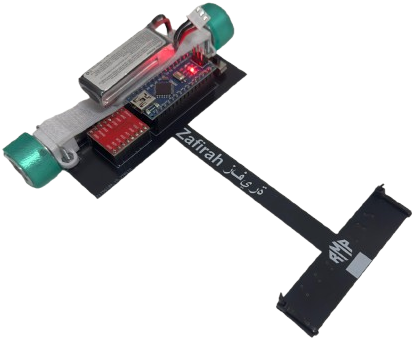

# RMP Zafirah

> **Sitio del robot:** [srampello.github.io/RMP_Zafirah](https://srampello.github.io/RMP_Zafirah/) · [Ficha en RMP Robotics](https://srampello.github.io/RMP/robots/zafirah/) · [Todos los robots](https://srampello.github.io/RMP/)

Repositorio principal de **Zafirah** (زافيرة), seguidor de línea de competición de RMP Robotics. Es el robot que se usa como plataforma de pruebas: los cambios de control se ensayan primero acá.

<p align="center">
  
</p>

<p align="center">
  
</p>

## Configuración actual

- Arduino Nano (ATmega328P, 16 MHz)
- 8 × QRE1113GR en las entradas analógicas A0–A7
- TB6612FNG
- 2 × N20 6 V 2000 RPM
- Botón de calibración, largada y pausa
- LED de estado y LED de largada

## Pinout

| Pin | Función |
|---:|---|
| A0–A7 | Sensores QRE1113GR (A0 = izquierda, A7 = derecha) |
| D2 | Botón (activo en LOW) |
| D3 | LED de largada |
| D4 | BIN1 |
| D5 | BIN2 |
| D6 | STBY del TB6612FNG |
| D7 | AIN1 |
| D8 | AIN2 |
| D9 | PWMA, motor derecho |
| D10 | PWMB, motor izquierdo |
| D13 | LED de estado (recta) |

## Firmware

### Seguidor — [`firmware/Zafirah/`](firmware/Zafirah/)

PID a ritmo fijo de 2 ms con velocidad extra en recta, freno en curva, reversa de la rueda interna, arranque con rampa y giro de recuperación cuando pierde la línea. Lee los sensores con su propio código (ADC de 8 bits, calibración con umbral): **no necesita librerías**.

| Paso | Qué hacer |
|---|---|
| 1 | Encender y apretar el botón: a los 0,75 s el LED empieza a parpadear y calibra 5 s. Pasar la barra varias veces sobre la línea y el fondo. |
| 2 | Apoyar el robot sobre la línea y apretar el botón: se enciende el LED de largada. |
| 3 | Al soltar el botón arranca, con la velocidad subiendo en rampa. |
| 4 | Mantener apretado el botón frena el robot; al soltarlo vuelve a arrancar con rampa. |

## Documentación

- [Conexiones](docs/CONEXIONES.md)
- [Firmware y parámetros](firmware/Zafirah/README.md)
- [Changelog](CHANGELOG.md)

## Estructura

```text
RMP_Zafirah/
├── docs/
│   └── CONEXIONES.md
├── firmware/
│   └── Zafirah/
├── images/
├── CHANGELOG.md
└── index.html
```

`index.html` es el sitio del robot y se genera desde [RMP/tools/web](https://github.com/srampello/RMP/tree/master/tools/web): no editarlo a mano.
